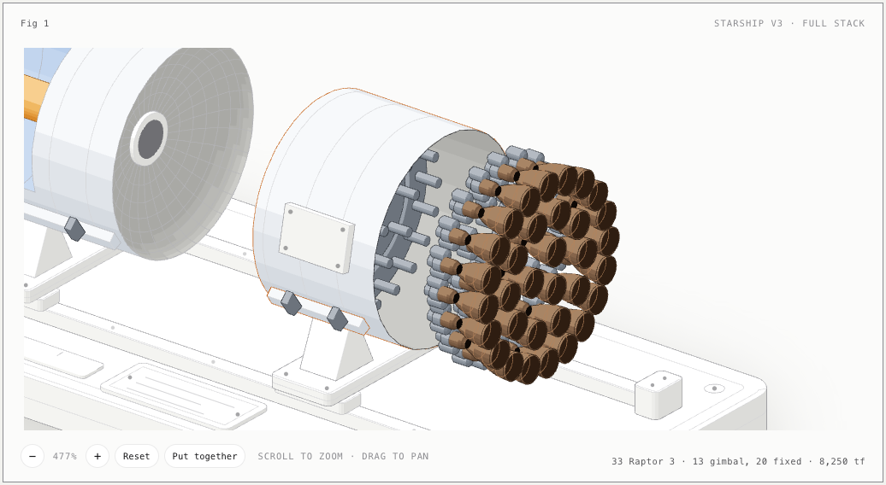
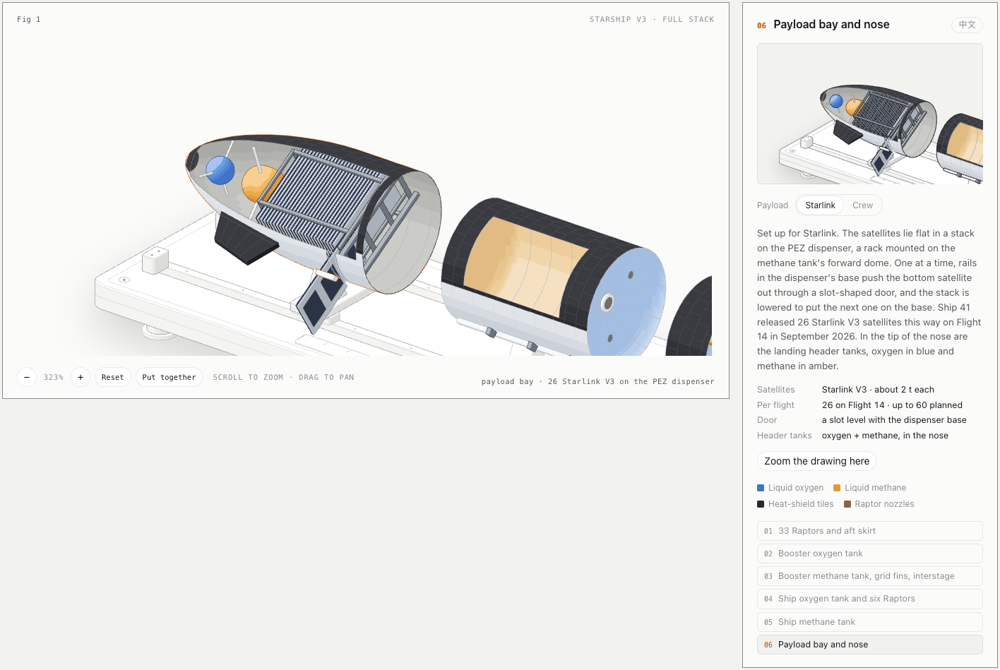
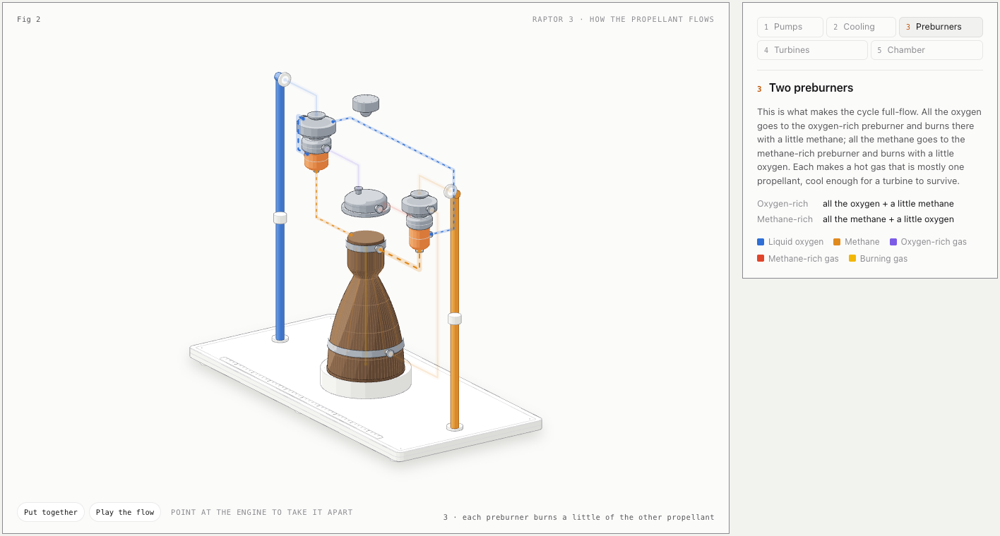
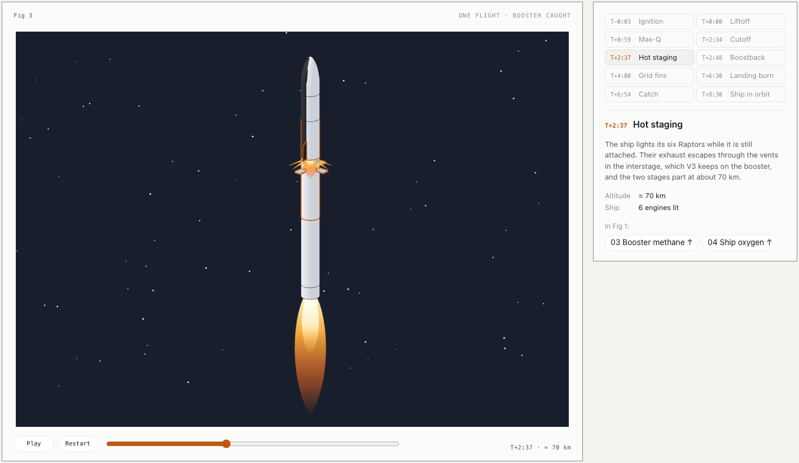
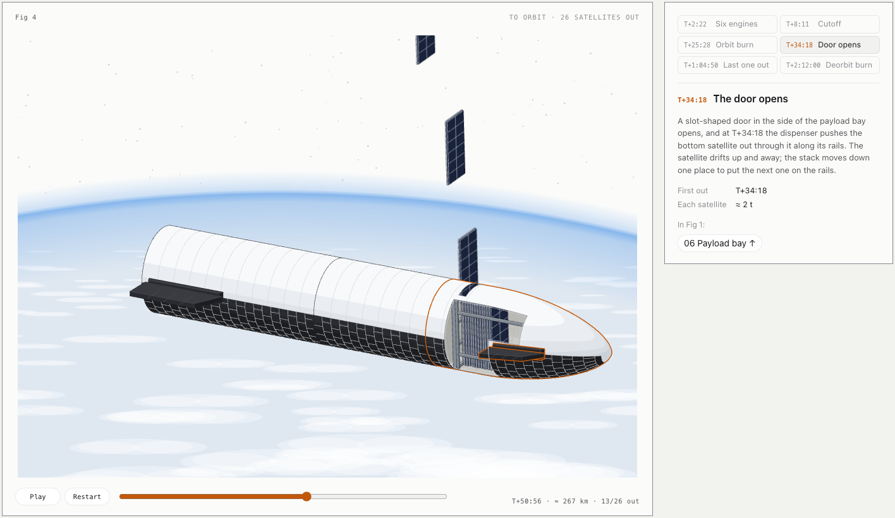
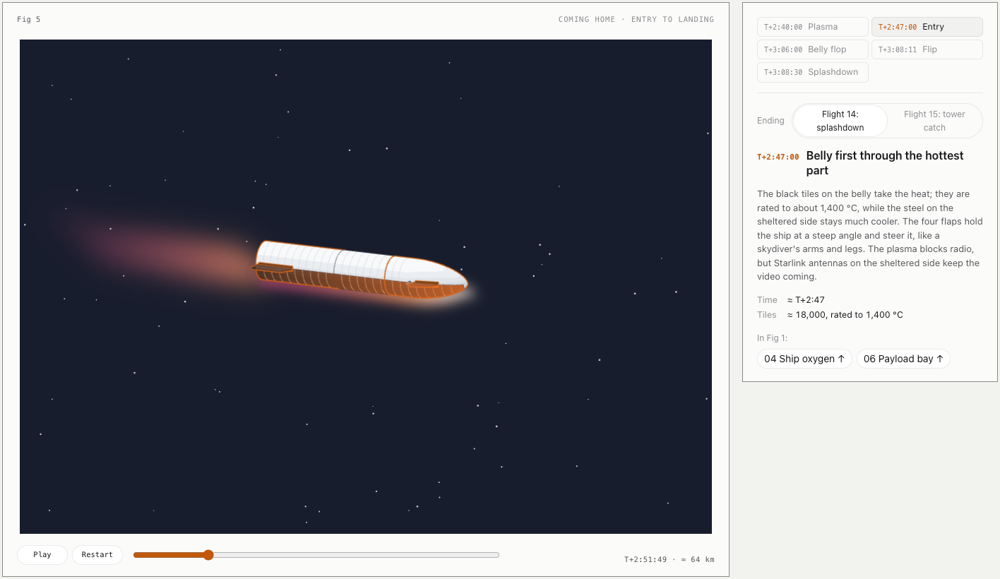

# Starship V3, taken apart

> Inspired by and built with **[wheresryan22/anatomy](https://github.com/wheresryan22/anatomy)**, a Claude Code skill that explains an idea by building it as a working isometric object. The drawing kit in `source/kit/` comes from that repository (MIT).

An interactive isometric figure of the SpaceX Starship V3 full stack. Point at it and it comes apart into the six sections it is stacked from, then all 39 Raptor engines slide out of their skirts. Cutaway windows show how the tanks are arranged inside and what rides in the payload bay (Starlink satellites or a crew cabin), a side panel shows each section close up with its numbers, and the drawing zooms so you can look at any part.

English and 中文: the page follows your browser's language; switch with the button at the top right of the page, or add `?lang=zh` or `?lang=en` to the link.






A second figure below it takes one Raptor 3 apart and walks through how its propellants flow:



A third figure plays one whole flight, from the pad to the booster's catch:



A fourth follows the ship to orbit and watches it let its 26 Starlink satellites go:



And a fifth brings the ship home, with two endings: Flight 14's splashdown, or the tower catch planned for Flight 15:



## View it

**Live: https://starcraftsu.github.io/starship-anatomy/** — follows your system's light or dark setting. Or go straight to the [light](https://starcraftsu.github.io/starship-anatomy/starship-light.html) or [dark](https://starcraftsu.github.io/starship-anatomy/starship.html) page.

To view it offline, download `starship-light.html` or `starship.html` and open it in a browser. Each page is a single self-contained file that makes no network requests. It carries the code that draws the figures rather than the drawings themselves (350 KB, about 110 KB compressed, instead of 3.9 MB): Fig 1 is drawn as the page opens, and the others when you scroll near them or when the browser is idle.

| To | Mouse | Touch | Keyboard (figure focused) |
|---|---|---|---|
| Pick a section | point at it, or use the list in the panel | tap it | arrow keys, Home, End |
| Take it apart / put it together | moves apart while you point at it; **Take apart** keeps it apart | tap empty space | Space |
| Zoom | scroll wheel, double-click, **+** / **−** | pinch | + and − |
| Pan | drag | drag with one finger | — |
| Frame the picked section | **Zoom the drawing here** in the panel | same | — |
| Reset | **Reset** | **Reset** | 0, or Escape for everything |
| Change the payload | pick 06, then **Starlink** or **Crew** in the panel | same | — |
| Change language | **中文** / **English** at the top right of the page | same | — |

Left alone, it runs a slow tour through the sections, and the panel follows. Under reduced motion it stays still.

## Fig 2: inside one Raptor 3

Assembled, the engine looks the way Raptor 3 really does: almost no pipes, because SpaceX moved Raptor 2's plumbing and sensors into the engine's main structure. Point at it and it comes apart on its stand. The oxygen turbopump and its preburner move left, the methane pair moves right, and coloured paths show the routes the housings hide. Five steps walk through the full-flow staged combustion cycle:

| Step | What lights up |
|---|---|
| 1 Two pumps | liquid oxygen and methane from the standpipes into the two turbopumps |
| 2 Methane cools the engine | methane down to the nozzle manifold and up through the wall channels |
| 3 Two preburners | all the oxygen (plus a little methane) to one preburner, all the methane (plus a little oxygen) to the other |
| 4 Turbines, then the injector | oxygen-rich gas spins the oxygen pump, methane-rich gas the methane pump; both gases go on to the injector |
| 5 Main chamber | gas meets gas at 330 bar and leaves through the nozzle |

Pick a step in the panel, use the arrow keys, or press **Play the flow**. Left alone it runs the steps as a tour. The paths are a diagram of the cycle, not the engine's real internal passages, and the parts are simplified.

## Fig 3: one flight

The stack stands on its launch mount beside the tower with its two catch arms. A timeline plays the flight in under a minute; drag it, press **Play**, pick an event, or use the arrow keys and Space. Left alone, it plays when you scroll to it.

| Event | Time (Flight 5) | Linked to Fig 1 |
|---|---|---|
| Ignition, liftoff | T−0:03, T+0:00 | 01 engines |
| Max-Q | T+0:59 | — |
| Main engine cutoff | T+2:34 | 01 engines |
| Hot staging, about 70 km up | T+2:37 | 03 interstage, 04 ship engines |
| Flip and boostback (ends T+3:41) | T+2:48 | 01 engines |
| Falling back on the grid fins | T+4:00 | 03 grid fins |
| Landing burn | T+6:30 | 01 engines |
| Caught by the tower | T+6:54 | 03 grid fins |
| Ship in orbit | about T+8:30 | 04, 06 payload; continues in Fig 4 |

Each event outlines the parts it uses on the rocket in Fig 3, and its buttons in the panel jump up to Fig 1 with that section picked and taken apart. The camera follows the vehicle, the sky darkens with altitude, and the readout gives mission time and approximate altitude.

## Fig 4: to orbit, and the satellites out

The ship flies on alone above the curve of the Earth, its payload bay cut open on the side facing you so the stack of satellites on the dispenser shows. The same controls as Fig 3 play it.

| Event | Time (Flight 14) | What happens |
|---|---|---|
| Six engines | T+2:22 | three sea-level and three vacuum Raptors burn; in vacuum the flame fans out wide and faint |
| Cutoff | T+8:11 | engines off, just short of orbit, the ground sliding by underneath |
| Orbit burn | T+25:28, 19 s | a short burn lifts the low point of the path out of the atmosphere: 262 × 275 km |
| Door opens | T+34:18 | the slot door opens; the bottom satellite slides out, the stack moves down a place, again and again |
| Last one out | T+1:04:50 | the 26th satellite leaves and the door closes |
| Deorbit burn | T+2:12:00, 11 s | the ship turns round (the ground now slides the other way) and burns against its direction of travel |

The readout counts the satellites out. Each event lights its section and links to it in Fig 1: 04 for the engines, 06 for the payload bay. The deorbit burn links on to Fig 5.

## Fig 5: coming home

The camera follows the ship down until the ground comes into view. The panel switches between two endings: what Flight 14 did, and what Flight 15 is to try.

| Event | Time (Flight 14) | What happens |
|---|---|---|
| Plasma | ≈ T+2:40 | belly first into the top of the atmosphere at more than 7 km/s; a glowing sheath and wake |
| Entry | ≈ T+2:47 | the hottest part: the tiles glow, the flaps hold the ship at a steep angle |
| Belly flop | ≈ T+3:06 | slower than sound, it falls flat through the clouds |
| Flip | ≈ T+3:08:11 | three Raptors light, the ship swings upright, then brakes on 3 → 2 → 1 engines |
| Splashdown | T+3:08:30 | upright in the Pacific; it tips over and its leftover propellant ignites about six seconds later |
| Tower catch (Flight 15 plan) | no date yet | it lands beside the tower and the arms close under pins on its sides |

The ship is drawn at 19 angles from flat to upright; it turns about a point 18 m up its axis during the flip and about its base when it tips over in the water.

## What Fig 1 shows

The stack lies on a long stacking jig: a base plate with two rails, a metre ruler (zero at the booster's engine plane) and cradles that slide along the rails.

Colour marks what things are: blue for liquid-oxygen spaces, amber for methane (so the methane tube running through the blue oxygen tank stands out), black for the heat-shield tiles, bronze for the regeneratively cooled Raptor nozzles and pale grey for the Raptor Vacuum nozzle extensions.

| # | Section | What to look for |
|---|---|---|
| 01 | 33 Raptors and aft skirt | 3 + 10 + 20 engine rings; apart, the engines slide out and leave the thrust puck and their mounts |
| 02 | Booster oxygen tank | Cutaway with the methane transfer tube running through it; aft dome with V3's metallic tiles |
| 03 | Booster methane tank, grid fins, interstage | Cutaway, common dome, three V3 grid fins, vented interstage kept on the booster |
| 04 | Ship oxygen tank and six Raptors | 3 sea-level + 3 vacuum engines that slide out into the staging gap, aft flaps, cutaway with four downcomers |
| 05 | Ship methane tank | Cutaway, common dome with downcomer inlets |
| 06 | Payload bay and nose | Cutaway of the bay and the header tanks. **Starlink**: 26 satellites stacked on the PEZ dispenser; the bottom one slides out through the slot door when you pick the section. **Crew**: three levels (quarters, a cabin with windows, two airlocks) with two people for scale. Forward flaps on both |

For sections 01 and 04 the panel links down to Fig 2, which takes one Raptor 3 apart. The engines in Fig 1 are simplified: nozzle, chamber, powerhead, two turbopumps and gimbal block.

The ship lies belly up so the heat-shield tiles and flaps face the viewer.

## Numbers and sources

| Quantity | Value | Source |
|---|---|---|
| Stack / booster / ship height | 124.4 m / 72.3 m / 52.1 m | [Super Heavy](https://en.wikipedia.org/wiki/SpaceX_Super_Heavy) and [Starship](https://en.wikipedia.org/wiki/SpaceX_Starship) on Wikipedia; ship height is the difference |
| Diameter, ring height | 9 m, 1.83 m | [Starship, Wikipedia](https://en.wikipedia.org/wiki/SpaceX_Starship) |
| Raptor 3 thrust | 250 tf sea level, 275 tf vacuum | SpaceX's May 2026 figures as given on [Raptor, Wikipedia](https://en.wikipedia.org/wiki/SpaceX_Raptor) |
| Booster propellant | 3,650 t | [Super Heavy, Wikipedia](https://en.wikipedia.org/wiki/SpaceX_Super_Heavy) |
| Ship propellant | about 1,600 t | [Starship, Wikipedia](https://en.wikipedia.org/wiki/SpaceX_Starship) (no official V3 figure found) |
| LOX / methane split | 3.6 : 1 by mass | Raptor's mixture ratio, applied to the totals above |
| Raptor 3 mass | 1,525 kg | [Raptor, Wikipedia](https://en.wikipedia.org/wiki/SpaceX_Raptor) |
| Flight timeline | Max-Q T+0:59, cutoff T+2:34, staging about 70 km, boostback ends T+3:41, landing burn T+6:30, catch T+6:54 (Flight 5, October 2024) | [The Space Bucket](https://thespacebucket.com/what-exactly-happened-on-starships-fifth-launch-attempt/) |
| Raptor size and nozzle | 3.1 m long, 1.3 m across; expansion ratio 34.34 sea level, 80 vacuum | [Raptor, Wikipedia](https://en.wikipedia.org/wiki/SpaceX_Raptor) |
| Raptor 3 chamber pressure, specific impulse | 330 bar (350 bar reached in testing); 350 s sea level, 380 s vacuum version | [Raptor, Wikipedia](https://en.wikipedia.org/wiki/SpaceX_Raptor) |
| Heat shield | about 18,000 tiles, rated to 1,400 °C | [Starship spacecraft, Wikipedia](https://en.wikipedia.org/wiki/SpaceX_Starship_(spacecraft)) |
| Grid fins, interstage | 3 fins about 1.5× earlier ones; interstage built into the methane tank and kept | [Super Heavy, Wikipedia](https://en.wikipedia.org/wiki/SpaceX_Super_Heavy) |
| PEZ dispenser | mounted on the forward dome; satellites pushed out one at a time from the base, the stack lowered for the next | [Starship spacecraft, Wikipedia](https://en.wikipedia.org/wiki/SpaceX_Starship_(spacecraft)) |
| Starlink V3 | 26 deployed on Flight 14 (September 2026); about 2 t each; up to 60 per flight planned | [TelecomTV](https://www.telecomtv.com/content/next-gen-telco-infra/spacex-deploys-v3-starlink-satellites-as-starship-reaches-orbit-56354/), [Tesla Oracle](https://www.teslaoracle.com/?p=66693) |
| Flight 14 timeline | cutoff T+8:11, orbit burn T+25:28 for 19 s into 262 × 275 km at 30.5°, satellites out T+34:18 to T+1:04:50, deorbit burn T+2:12:00 for 11 s, entry about T+2:47 ([NASASpaceFlight](https://www.nasaspaceflight.com/2026/09/starship-flight-14-orbit/); Wikipedia's table lists entry, flip and landing-burn start 18 minutes early), splashdown T+3:08:30 | [Starship flight 14, Wikipedia](https://en.wikipedia.org/wiki/Starship_flight_14) |
| Flight 14 entry and landing | plasma ≈ T+2:40, entry ≈ T+2:47; landing burn 3 → 2 engines at T+3:08:20, 2 → 1 at T+3:08:26; splashdown T+3:08:30 north of Hawaii; exploded about six seconds later; not to be recovered | [NASASpaceFlight](https://www.nasaspaceflight.com/2026/09/starship-flight-14-orbit/), [Starship flight 14, Wikipedia](https://en.wikipedia.org/wiki/Starship_flight_14) |
| Ship catch | first try planned for Flight 15 (Ship 42, Pad 2), about November 2026; Pad 2's arms lifted Ship 42 into catch position in September ground tests; first-try odds "at least 50 or 60 percent" (Elon Musk) | [KeepTrack](https://keeptrack.space/x-report/spacex-brief-2026-10-13), [Starship Flight 15 wiki](https://starship-spacex.fandom.com/wiki/Starship_Flight_15), [SatNews](https://satnews.com/2026/07/25/spacex-targets-first-starship-upper-stage-tower-catch-for-flight-14/) |
| Crew layout | lunar lander (HLS): two airlocks, an elevator, crew area at the top; up to 100 crew planned for Starship | [Starship spacecraft, Wikipedia](https://en.wikipedia.org/wiki/SpaceX_Starship_(spacecraft)) and SpaceX's HLS renders |

Caveats:

- Sources disagree on some V3 numbers. An April 2026 review gives about 3,400 t of booster propellant and 280 t per Raptor 3; this figure uses the later May 2026 values.
- The header tanks are drawn in the nose, where they have been since Ship 24; their V3 placement is not confirmed.
- The PEZ slot and the satellites are drawn from press descriptions (folded V3 satellites about 7 × 3.5 m); their exact sizes and the rack's layout are not published.
- Fig 3's times follow Flight 5, the first catch; V3 flights may differ by seconds. Altitudes between the sourced points are interpolated, the timeline is compressed, and heights on screen above the tower are not to scale. The ship's time in orbit is approximate.
- Fig 4 spaces the 26 satellites evenly between the first and the last (about 70 s apart), and its altitudes between the sourced points are approximate. SpaceX has not published how the dispenser moves the stack, which engines made the orbit and deorbit burns, or the ship's attitude while it deployed; the flame, how fast the satellites drift away and the Earth below are drawn for clarity, not to scale.
- Fig 5: Wikipedia's Flight 14 table puts entry, the flip and the start of the landing burn 18 minutes earlier than the rest of its rows allow (a 20-minute fall after going subsonic, an 18-minute landing burn); the figure takes them 18 minutes later, which agrees with NASASpaceFlight's entry time and the splashdown. The belly-flop time and the altitudes are approximate. Where the ship's catch pins are is not published: they are drawn below the forward flaps, where the arms reach. The plasma, flame, clouds and ocean are drawn for clarity, not to scale.
- No crewed Starship has flown. The crew cabin is illustrative, after SpaceX's lunar-lander renders; the real lander also has no flaps or heat shield and has landing legs.
- Engine proportions: 3.1 m long; nozzle exits drawn 1.2 m across (Wikipedia gives the engine as 1.3 m across, but twenty nozzles have to fit in a ring around the 9 m booster), throats sized from Wikipedia's expansion ratios (34.34 at sea level, 80 for the vacuum version, which shares the throat, giving a 1.8 m vacuum nozzle). Raptor 3's internal layout is not published; Fig 2 arranges its parts after the usual full-flow layout and simplifies them to turned shapes.
- Proportions inside the tanks (dome depths, tube diameters, engine spacing) are approximate. Chines are left off because it is unclear whether V3 boosters keep them.

## Rebuild

Needs Node.js 20.10 or later and nothing else (no `npm install`).

```sh
node source/build.mjs --light   # writes starship-light.html
node source/build.mjs           # writes starship.html
```

- `source/build.mjs` writes the page: the words, panels and controls as HTML, and the figure modules bundled into one script with a few lines of bundler (no dependencies).
- `source/stack.mjs` holds the model for Fig 1 (every number above), all its geometry, and the words of the page header and Fig 1 in English and Chinese. `source/live.js` is Fig 1's interaction: the tour, zoom and pan, the side panel, the payload switch, pointer, touch and keyboard.
- `source/raptor.mjs` and `source/raptor-live.js` are Fig 2: the engine, its flow paths and text, and its steps, play mode and tour.
- `source/boot.js` draws each figure in the page and starts it; `source/runtime.js` is what every figure's script shares (the page language, panel helpers, the frame loop that only runs on screen, the spring); `source/parts.mjs` is the markup every figure module shares; `source/timeline.js` is what Figs 3 and 4 share (keyframe tracks, the event panel and its links, Play, the scrubber, keys and autoplay).
- `source/flight.mjs` and `source/flight-live.js` are Fig 3: the launch site, the booster drawn at 25 rotation angles, the arms at 13 positions, the timeline's keyframes and events, and its scene.
- `source/orbit.mjs` and `source/orbit-live.js` are Fig 4: the ship with its cutaway and door, the 26 satellites (one small layer each), the Earth's limb and clouds, the flame, and the deployment schedule.
- `source/home.mjs` and `source/home-live.js` are Fig 5: the ship at 19 pitch angles, the plasma and hot tiles, the ocean, the fireball and the two endings; `source/site.mjs` is the launch tower, arms and mount it shares with Fig 3.
- `source/starship.css` holds the page styles and the colour tokens for every material, light and dark.
- `source/kit/` is a copy of the drawing kit the build uses, with two hot spots sped up for drawing in the browser (the lathe's waist test and coordinate formatting; the output is byte for byte the same).

## Credits

Made with Claude Code using the [anatomy](https://github.com/wheresryan22/anatomy) skill. `source/kit/iso-kit.mjs` and `source/kit/lathe.mjs` are copied unchanged from that project and are under its MIT license (`source/kit/LICENSE`).

Not affiliated with SpaceX.
