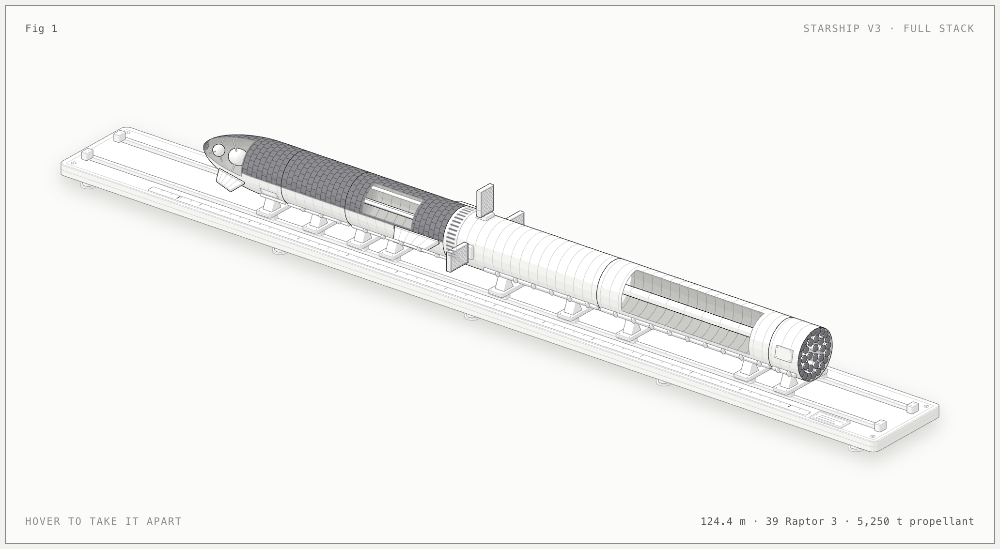
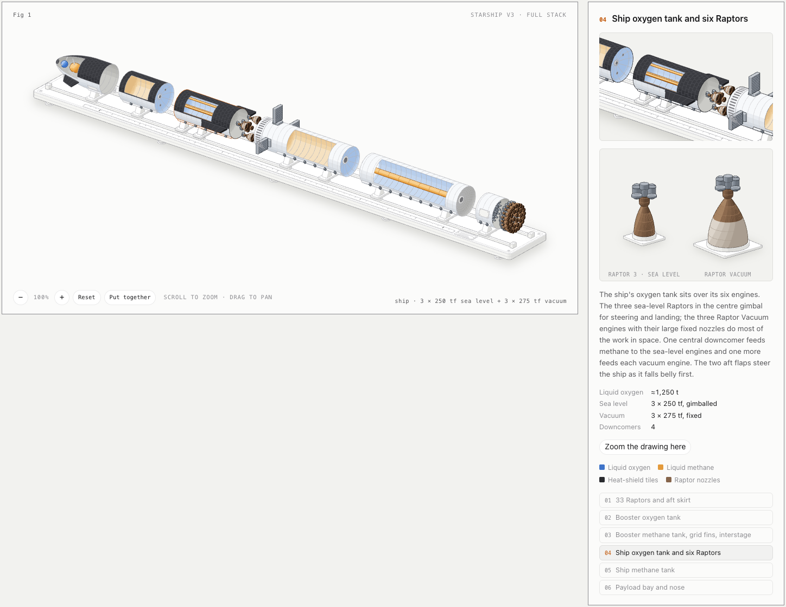

# Starship V3, taken apart

> Inspired by and built with **[wheresryan22/anatomy](https://github.com/wheresryan22/anatomy)**, a Claude Code skill that explains an idea by building it as a working isometric object. The drawing kit in `source/kit/` comes from that repository (MIT).

An interactive isometric figure of the SpaceX Starship V3 full stack. Hover over it and it comes apart into the six sections it is stacked from, with cutaways that show how the tanks are arranged inside.





## View it

Download `starship-light.html` (light theme) or `starship.html` (dark theme) and open it in a browser. Each page is a single self-contained file that makes no network requests.

- **Hover** over the figure to take it apart; the section under the pointer is highlighted and the readout shows its numbers.
- **Legend buttons**, or the **arrow keys** once the figure has focus, step through the sections. **Space** toggles apart/assembled, **Escape** puts it back together.
- Left alone, it runs a slow tour of the sections. Under reduced motion it stays still.

## What the drawing shows

The stack lies on a long stacking jig: a base plate with two rails, a metre ruler (zero at the booster's engine plane) and cradles that slide along the rails.

| # | Section | What to look for |
|---|---|---|
| 01 | 33 Raptors and aft skirt | 3 + 10 + 20 engine rings |
| 02 | Booster oxygen tank | Cutaway showing the methane transfer tube running through it; aft dome with V3's metallic tiles |
| 03 | Booster methane tank, grid fins, interstage | Common dome, three V3 grid fins, vented interstage kept on the booster |
| 04 | Ship oxygen tank and six Raptors | 3 sea-level + 3 vacuum engines, aft flaps, cutaway with four downcomers |
| 05 | Ship methane tank | Common dome with downcomer inlets |
| 06 | Payload bay and nose | Payload door, forward flaps, cutaway of the landing header tanks in the nose |

The ship lies belly up so the heat-shield tiles and flaps face the viewer.

## Numbers and sources

| Quantity | Value | Source |
|---|---|---|
| Stack / booster / ship height | 124.4 m / 72.3 m / 52.1 m | [Super Heavy](https://en.wikipedia.org/wiki/SpaceX_Super_Heavy) and [Starship](https://en.wikipedia.org/wiki/SpaceX_Starship) on Wikipedia; ship height is the difference |
| Diameter, ring height | 9 m, 1.83 m | [Starship, Wikipedia](https://en.wikipedia.org/wiki/SpaceX_Starship) |
| Raptor 3 thrust | 250 tf sea level, 275 tf vacuum | SpaceX's May 2026 figures as given on [Raptor, Wikipedia](https://en.wikipedia.org/wiki/SpaceX_Raptor) |
| Booster propellant | 3,650 t | [Super Heavy, Wikipedia](https://en.wikipedia.org/wiki/SpaceX_Super_Heavy) |
| Ship propellant | about 1,600 t | [Starship, Wikipedia](https://en.wikipedia.org/wiki/SpaceX_Starship) (no official V3 figure found) |
| LOX / methane split | 3.6 : 1 by mass | Raptor's mixture ratio, applied to the totals above |

Caveats:

- Sources disagree on some V3 numbers. An April 2026 review gives about 3,400 t of booster propellant and 280 t per Raptor 3; this figure uses the later May 2026 values.
- The header tanks are drawn in the nose, where they have been since Ship 24; their V3 placement is not confirmed.
- Proportions inside the tanks (dome depths, tube diameters, engine spacing) are approximate. Chines are left off because it is unclear whether V3 boosters keep them.

## Rebuild

Needs Node.js 20.10 or later and nothing else (no `npm install`).

```sh
node source/build.mjs --light   # writes starship-light.html
node source/build.mjs           # writes starship.html
```

- `source/build.mjs` holds the model (every number above) and all the geometry.
- `source/live.js` is the interaction: springs, the tour, pointer and keyboard.
- `source/starship.css` holds the page styles and the theme tokens for cavities and tiles.
- `source/kit/` is a copy of the drawing kit the build uses.

## Credits

Made with Claude Code using the [anatomy](https://github.com/wheresryan22/anatomy) skill. `source/kit/iso-kit.mjs` and `source/kit/lathe.mjs` are copied unchanged from that project and are under its MIT license (`source/kit/LICENSE`).

Not affiliated with SpaceX.
